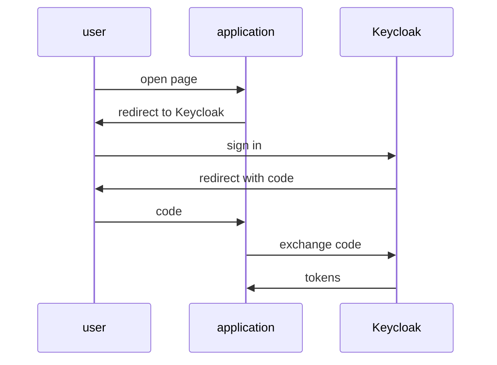

# What Keycloak Does And Where It Fits

Every application that has users must answer two questions: who is this user, and what may they do? If each application answers them on its own, each one stores passwords, builds a login page and handles password resets. This part explains how an identity provider takes that work away from the applications. It also shows where Keycloak sits among the identity projects of the Cloud Native Computing Foundation (CNCF).

## The job of an identity provider

An identity provider (IdP) is a service that checks who a user is and tells applications the result, in a signed token or assertion. The application sends the user to the identity provider to sign in. The identity provider checks the password, and any second factor, and sends the user back with a token. The application checks the signature on the token and trusts what it says.



The diagram shows a browser sign-in: the application never sees the password, only the tokens Keycloak returns.

This one design gives every application the same benefits. Passwords live in one place. Single sign-on (SSO) works: a user who signed in for one application is already signed in for the next one in the same realm. A realm is a space in Keycloak that holds its own users, clients, roles, groups and settings. Security features such as one-time passwords, passkeys and account lockout are set up once, in Keycloak, not in every application.

Keycloak calls each application a **client**. A client is an application or service that asks Keycloak to sign users in or to issue tokens. Keycloak knows each client by its client ID, for example `inventory-cli`, and only issues tokens to clients that exist in the realm.

## What Keycloak covers

Keycloak is an open source identity and access management (IAM) server. Identity and access management is the work of creating user accounts, checking who a user is, and deciding what each user may reach. Keycloak covers these jobs in one server:

| Job | What Keycloak does |
| --- | --- |
| Sign-in | Shows the login page, checks passwords, one-time passwords and passkeys |
| Tokens | Issues signed tokens over OpenID Connect and OAuth 2.0, and assertions over SAML 2.0 |
| Users | Stores users, groups and roles, or reads them from LDAP or Active Directory (user federation) |
| Identity brokering | Lets users sign in with another identity provider, such as a social login or a company IdP |
| Administration | An Admin Console in the browser, an Admin REST API, and the `kcadm.sh` command-line tool |
| Authorization | Fine-grained rules about which user may reach which resource (Authorization Services) |

The two protocol families do the same job in different formats. OpenID Connect (OIDC) and OAuth 2.0 use JSON and HTTP and fit modern web, mobile and API clients. SAML 2.0 uses XML and fits older enterprise applications.

## Keycloak in the CNCF landscape

The CNCF is the foundation that hosts Kubernetes and many other open source cloud native projects. Keycloak joined the CNCF as an incubating project in April 2023. Incubating means the project is used in production by several organisations and is working towards the graduated level.

Several CNCF projects deal with identity, and they are easy to mix up. Each one answers a different question:

| Project | The question it answers |
| --- | --- |
| Keycloak | Who is this **user**, and which tokens may this client get? A full identity provider with its own user store and login pages |
| Dex | How can Kubernetes and other tools sign users in through an identity provider that already exists? Dex is an OpenID Connect provider that connects to other identity providers and has no full user management of its own |
| SPIFFE and SPIRE | Who is this **workload**? They give services, not people, a cryptographic identity |
| Open Policy Agent (OPA) | Is this request allowed? A policy engine; it decides on a request, but does not sign anyone in |

So Keycloak is the project to use when people sign in to applications. It often works next to the others: an API can check a Keycloak token and then ask OPA whether the request is allowed.

## Look at the playground

The playground runs Keycloak 26.8.1 in the namespace `protocols-demo`. Start by checking that both pods are ready.

<!-- astrona:playground:renew -->

```sh
kubectl -n protocols-demo get pods
```

Both pods, `keycloak-...` and `tester-...`, show `1/1` and `Running`. If the `keycloak` pod shows `0/1`, Keycloak is still starting; wait a minute and run the command again.

Every realm publishes a small JSON document at `/realms/<realm>`. Ask Keycloak for the one of the realm `inventory`, from the `tester` pod:

```sh
kubectl -n protocols-demo exec deploy/tester -- \
  curl -s http://keycloak:8080/realms/inventory | jq
```

The response is a JSON object with the field `realm` set to `inventory`, the realm's public key in `public_key`, and the URLs of the realm's token service and account service. The `tester` pod reached Keycloak through the Service `keycloak` on port `8080`, and Keycloak answered for the realm named in the path.

Ask for a realm that does not exist, to see the difference:

```sh
kubectl -n protocols-demo exec deploy/tester -- \
  curl -s -o /dev/null -w '%{http_code}\n' http://keycloak:8080/realms/does-not-exist
```

The command prints `404`. Every URL Keycloak serves for applications starts with `/realms/<realm>`, so the realm name in the URL decides which users and clients a request can reach.

You now know what an identity provider does, which jobs Keycloak takes away from an application, and how Keycloak differs from Dex, SPIFFE and OPA. You have also seen that each realm has its own URL path. The open question is how a client actually gets a token from that realm, and that is what OAuth 2.0 defines.

## Common pitfalls

> [!WARNING]
> - **Treating Keycloak as a policy engine.** Keycloak signs users in and issues tokens. Deciding whether one request to an API is allowed is the job of the API, often with a policy engine.
> - **Mixing up user identity and workload identity.** SPIFFE and SPIRE identify services; Keycloak identifies people (and service accounts of clients). They solve different problems.
> - **Forgetting the realm in the URL.** Every application URL is `/realms/<realm>/...`. A wrong realm name returns `404`, not an error about the user.
> - **Calling every application a "user".** In Keycloak, the application is a **client**. A user is a person (or a service account) in a realm.
