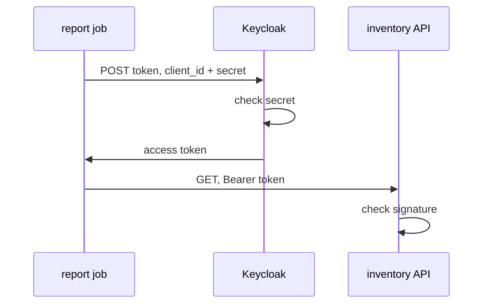

# OAuth 2.0 And The Client Credentials Grant

A report job runs every night and calls an inventory API. No person is signed in, so there is no user to ask for a password. The job still needs a token, and the API still needs to know which program is calling. This part explains how OAuth 2.0 solves that case with the client credentials grant, and it is the first place you get a real token from Keycloak.

## The four roles in OAuth 2.0

OAuth 2.0 is a framework that lets a client get an access token to call an API, without seeing the user's password. An access token is a token a client sends to an API to show what it may do. OAuth 2.0 names four roles, and every request you send in this module plays one of them:

| Role | What it does | In the playground |
| --- | --- | --- |
| Resource owner | The person (or program) that owns the data and gives access | `alice`, or the report job itself |
| Client | The application that wants a token | `inventory-cli` or `inventory-reporter` |
| Authorization server | Checks who is asking and issues tokens | Keycloak, realm `inventory` |
| Resource server | The API that accepts the token | An inventory API (not deployed here) |

The client gets tokens from one place: the **token endpoint** of the realm. In Keycloak it is `/realms/<realm>/protocol/openid-connect/token`. The client sends an HTTP `POST` with form fields, and the most important field is `grant_type`. A grant type is the way a client gets a token. It decides what the client must prove and who the token is about.

| Grant type | Who the token is about | Used by |
| --- | --- | --- |
| `authorization_code` | A user who signed in through the browser | Web and mobile applications (the normal case) |
| `client_credentials` | The client itself, through its service account | Services and jobs with no user |
| `refresh_token` | The same user or client as before | Any client that holds a refresh token |
| `password` | A user whose password the client sends | Only tests and old applications; OAuth 2.1 drops it |

## Public clients and confidential clients

A client can only prove who it is if it can keep a secret. Keycloak splits clients into two kinds on that basis. A **public client** cannot keep a secret, for example a single page application in a browser or a command-line tool on a laptop; anyone can read its code. A **confidential client** can keep a secret, for example a service in a cluster. It proves who it is with a **client secret**, a password for the client that Keycloak generates.

The client credentials grant needs a confidential client. In this grant the client is both the resource owner and the client: it asks for a token for itself. Keycloak gives each such client a **service account**, a special user that represents the client in the realm. The client setting is called **Service accounts roles** in the Admin Console and `serviceAccountsEnabled` in the Admin REST API.



The diagram shows the client credentials grant: the job proves who it is with its client secret, gets an access token, and sends it to the API in the `Authorization: Bearer` header.

## Read the client settings with kcadm.sh

Before you request a token, look at how the client is set up. `kcadm.sh` is the administration command-line tool that ships in the Keycloak image; it calls the Admin REST API. The helper below runs it inside the Keycloak pod and keeps its session file in `/tmp`. Paste it into your terminal, then sign in to the `master` realm as the lab-only administrator:

<!-- astrona:playground:renew -->

```sh
NAMESPACE=protocols-demo
kcadm() {
  kubectl -n "$NAMESPACE" exec -i deploy/keycloak -- \
    /opt/keycloak/bin/kcadm.sh "$@" --config /tmp/kcadm.config
}
kcadm config credentials --server http://localhost:8080 --realm master --user admin --password admin
```

The second command prints a line that says it is logging in to `http://localhost:8080` as the user `admin` of the realm `master`. Now read the settings that decide which grants a client may use:

```sh
kcadm get clients -r inventory -q clientId=inventory-reporter \
  --fields clientId,publicClient,serviceAccountsEnabled,directAccessGrantsEnabled,standardFlowEnabled
```

The JSON shows `publicClient` as `false` and `serviceAccountsEnabled` as `true`, so `inventory-reporter` is a confidential client with a service account. `directAccessGrantsEnabled` and `standardFlowEnabled` are `false`, so this client cannot use the password grant or the browser flow. Each setting turns one grant type on or off for this client only.

## Request a token with the client credentials grant

Now send the request the report job would send. The `tester` pod posts the grant type, the client ID and the client secret to the token endpoint of the realm `inventory`:

```sh
kubectl -n protocols-demo exec deploy/tester -- \
  curl -s http://keycloak:8080/realms/inventory/protocol/openid-connect/token \
    -d grant_type=client_credentials \
    -d client_id=inventory-reporter \
    -d client_secret=inventory-reporter-secret | jq
```

The response is a JSON object with `access_token`, a long string in three parts separated by dots, `expires_in` set to `300` (seconds), and `token_type` set to `Bearer`. There is no `refresh_token`, because a client that holds its own secret can always ask for a new token.

The access token is a JSON Web Token (JWT): three Base64URL parts (header, payload, signature), separated by dots. The payload is plain JSON, only encoded, so you can read it without any key. The helper below decodes the middle part on your machine with `jq`:

```sh
decode_jwt() {
  jq -R 'split(".")[1] | gsub("-";"+") | gsub("_";"/") | @base64d | fromjson'
}
kubectl -n protocols-demo exec deploy/tester -- \
  curl -s http://keycloak:8080/realms/inventory/protocol/openid-connect/token \
    -d grant_type=client_credentials \
    -d client_id=inventory-reporter \
    -d client_secret=inventory-reporter-secret | jq -r .access_token | decode_jwt
```

The payload shows the claims of the token. `iss` (issuer) is `http://keycloak:8080/realms/inventory`, the realm that signed it. `azp` (authorized party) is `inventory-reporter`, the client that asked for it. `preferred_username` is `service-account-inventory-reporter`, the service account user Keycloak created for the client. `exp` is the time the token expires, in seconds since 1970.

## What a public client gets

The grant only works because the client is confidential and has a service account. Send the same grant type for the public client `inventory-cli`, which has no secret:

```sh
kubectl -n protocols-demo exec deploy/tester -- \
  curl -s http://keycloak:8080/realms/inventory/protocol/openid-connect/token \
    -d grant_type=client_credentials \
    -d client_id=inventory-cli | jq
```

Keycloak refuses the request. The response has no `access_token`; it has an `error` field and an `error_description` that says a public client may not get a service account token. The refusal comes from the authorization server, Keycloak, before any API is involved. Reading `error` and `error_description` is the fastest way to find out why the token endpoint said no.

You now know the four OAuth 2.0 roles, the grant types, and why the client credentials grant needs a confidential client with a service account. You have requested an access token and read its claims. The open question is how a client gets a token about a **user**, and how it learns who that user is; that is what OpenID Connect adds.

## Common pitfalls

> [!WARNING]
> - **Using client credentials with a public client.** A public client has no secret, so Keycloak refuses the grant. The client must be confidential, with **Service accounts roles** on.
> - **Turning on the password grant "to make it work".** A service that has no user needs `client_credentials`, not `password`. Turning on direct access grants adds a way to send user passwords through the client.
> - **Treating the JWT payload as secret.** The payload is only Base64URL-encoded. Anyone with the token can read it, so never put secrets in claims.
> - **Ignoring `error_description`.** The token endpoint says why it refused. Read the response before you change any setting.
> - **Putting the client secret in a Deployment as plain text.** Keep it in a Kubernetes Secret and read it from there.

## Your mission: Give A Service Client Its Own Token

You can now read a client's settings, request a token with the client credentials grant, and decode it. The graded lab gives you a report client that was created as a public client, and asks you to make it a confidential client with a service account and store its secret in a Kubernetes Secret, without turning on any grant it does not need.

The lab runs in its own cluster, so first pause your playground. Nothing in it is lost:

```sh
astrona stop ats-088-playground-010-01
```

Then start the lab:

```sh
astrona run --git ssh://git@github.com/astrona-io/ATS088.git -c sections/section-010/module-01/labs/lab-01
```

The task is on the next page. Solve it on your own first. When you think you are done, send it for grading:

```sh
astrona submit -c sections/section-010/module-01/labs/lab-01
```

When the lab is done, remove it and start your playground again:

```sh
astrona destroy ats-088-lab-010-01
astrona start ats-088-playground-010-01
```
