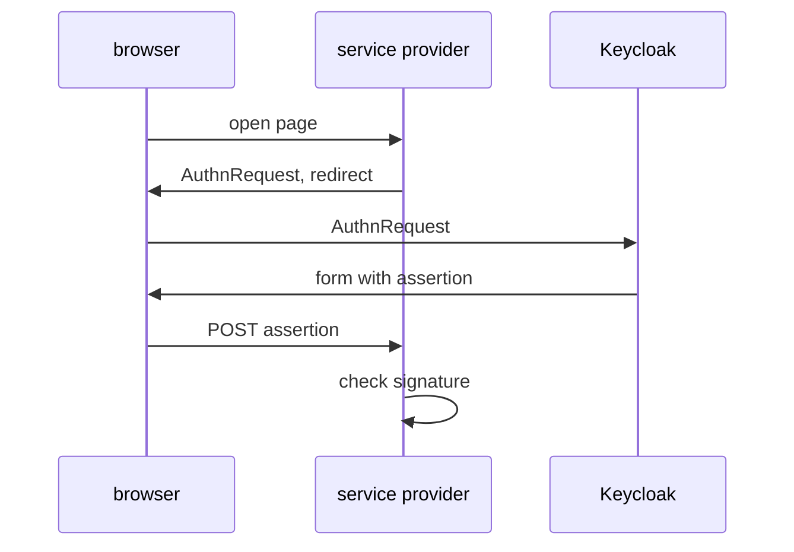

# SAML 2.0 And Choosing A Protocol

Many companies still run applications that were built before OpenID Connect existed: an older intranet portal, a ticket system, a business application bought years ago. Most of them sign users in with SAML 2.0. Keycloak speaks SAML as well as OpenID Connect, so one realm can serve both old and new applications. This part shows what SAML looks like in Keycloak and gives a clear rule for choosing a protocol for a new client.

## How SAML 2.0 works

SAML 2.0 (Security Assertion Markup Language) is an older XML-based standard where the identity provider sends a signed assertion about the user to a service provider. An assertion is an XML document that says who the user is, when and how they signed in, and which attributes they have. A service provider (SP) is SAML's name for the application; it plays the same part as a client in OpenID Connect.

The flow in the browser looks a lot like the OpenID Connect sign-in. The service provider sends the user to Keycloak with a SAML authentication request. Keycloak signs the user in, builds a signed assertion, and sends it back through the browser to the service provider, usually in an HTML form that the browser posts. The service provider checks the signature with Keycloak's certificate and signs the user in.



The diagram shows a SAML sign-in: the signed assertion travels from Keycloak to the service provider through the user's browser, never straight from server to server.

Two words in that flow are bindings. A binding is the way a SAML message travels over HTTP. **HTTP-Redirect** puts the message in the URL; **HTTP-POST** puts it in an HTML form that the browser posts. The two sides agree on the bindings, the URLs and the certificates by exchanging **metadata**: an XML document that describes one side of the setup.

## Read the realm's SAML metadata

Every realm publishes its identity provider metadata at `/realms/<realm>/protocol/saml/descriptor`. An administrator gives this URL, or the file, to the team that runs the service provider. Fetch the metadata of the realm `inventory` and print the first part of it:

<!-- astrona:playground:renew -->

```sh
kubectl -n protocols-demo exec deploy/tester -- \
  curl -s http://keycloak:8080/realms/inventory/protocol/saml/descriptor | head -c 1200; echo
```

The response is XML, not JSON. Its root element is an `EntityDescriptor` whose `entityID` is `http://keycloak:8080/realms/inventory`; that is the realm's identity in SAML, and it plays the same part as the issuer in OpenID Connect. Inside it, an `IDPSSODescriptor` element describes Keycloak as an identity provider, with a `KeyDescriptor` that holds the realm's signing certificate in an `X509Certificate` element.

The end of the document lists where a service provider sends its requests. Pull out the single sign-on lines:

```sh
kubectl -n protocols-demo exec deploy/tester -- \
  curl -s http://keycloak:8080/realms/inventory/protocol/saml/descriptor \
  | grep -o 'SingleSignOnService[^>]*'
```

Each line names a binding, such as `urn:oasis:names:tc:SAML:2.0:bindings:HTTP-POST` or `HTTP-Redirect`, and a `Location`. The location is `http://keycloak:8080/realms/inventory/protocol/saml` for each binding. One realm, one URL, several ways to reach it.

## One realm, both protocols

In Keycloak, the protocol is a setting of each client, not of the realm. The realm `inventory` can hold OpenID Connect clients and SAML clients side by side, and they share the same users, the same login page and the same single sign-on session. Sign in to `kcadm.sh` and list the clients of the realm with their protocol:

```sh
NAMESPACE=protocols-demo
kcadm() {
  kubectl -n "$NAMESPACE" exec -i deploy/keycloak -- \
    /opt/keycloak/bin/kcadm.sh "$@" --config /tmp/kcadm.config
}
kcadm config credentials --server http://localhost:8080 --realm master --user admin --password admin
kcadm get clients -r inventory --fields clientId,protocol
```

The list shows `inventory-cli` and `inventory-reporter` with the protocol `openid-connect`, next to the clients that Keycloak creates in every realm, such as `account` and `admin-cli`. A SAML client would show the protocol `saml`, and its client ID is usually the service provider's entity ID, a URL.

## Choosing a protocol

The two protocols do the same job, so the choice comes from the application, not from Keycloak. The table compares them on the points that matter:

| Point | OpenID Connect | SAML 2.0 |
| --- | --- | --- |
| Format | JSON, JWT | XML, signed with XML Signature |
| Built on | OAuth 2.0 | Its own standard |
| Tokens for APIs | Yes, the access token | No; SAML has no API token |
| Mobile and single page applications | Well supported | Poorly supported |
| Service-to-service calls | Client credentials grant | Not covered |
| Setup between the two sides | Discovery document, client ID and secret | Metadata files and certificates |
| Typical user | New web, mobile and API applications | Older enterprise applications, many software as a service products |

The rule follows from that table: **use OpenID Connect for every new application, and use SAML when the application only supports SAML.** An application that must call an API needs an access token, and only OAuth 2.0 and OpenID Connect provide one.

You now know how a SAML sign-in works, how to read a realm's SAML metadata, and how one realm serves both protocols. With that, you can read every protocol endpoint a Keycloak realm publishes. The open question for real work is which client settings each application needs, and that always starts with the protocol you chose here.

## Common pitfalls

> [!WARNING]
> - **Expecting JSON from the SAML endpoints.** SAML metadata and assertions are XML. Use `grep` or an XML tool to read them, not `jq`.
> - **Choosing SAML for an application that calls APIs.** SAML gives the application no access token to send to an API.
> - **Thinking a realm is "a SAML realm" or "an OIDC realm".** The protocol is set per client. One realm can hold both kinds.
> - **Changing the realm's signing key without telling the service providers.** SAML service providers often store Keycloak's certificate from the metadata. A new key breaks their signature check until they update the metadata.
