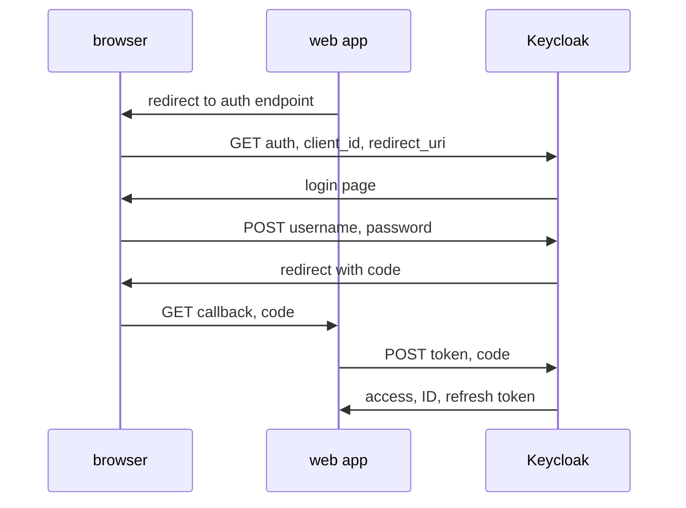

# The Authorization Code Flow Step By Step

A user opens the inventory web application and clicks Sign in. The application has no password to check and must not ask for one. Instead it sends the user to Keycloak, waits, and gets back something it can trade for tokens. This part follows that exchange one request at a time and runs it with `curl`, so you see which component sends which message.

## The two channels

The authorization code flow uses two different paths, and the difference is the reason the flow is safe. The **front channel** is the user's browser. Messages in the front channel travel in URLs, so the browser history, proxies and the user can see them. The **back channel** is a direct request from the client application to Keycloak. It does not pass through the browser.

Only the front channel carries the **authorization code**: a short-lived, single-use value that stands for "this user signed in". The tokens themselves travel only on the back channel, in the response to the token request. A code on its own is useless to an attacker unless the attacker can also make the token request as the same client.



The diagram shows the flow: the browser carries the code to the web application, and the application sends the code to the token endpoint of Keycloak itself.

## The authorization request

The first request goes to the **authorization endpoint** of the realm: `/realms/<realm>/protocol/openid-connect/auth`. It is an HTTP `GET` with these query parameters:

| Parameter | What it does |
| --- | --- |
| `client_id` | The client that asks for the sign-in, for example `inventory-web` |
| `response_type` | `code` selects the authorization code flow |
| `redirect_uri` | Where Keycloak sends the browser afterwards. It must match a redirect URI registered for the client |
| `scope` | The kinds of access the client asks for. `openid` makes it an OpenID Connect request |
| `state` | A random value the client invents. Keycloak returns it unchanged, so the client can tell the response belongs to its own request |
| `nonce` | A random value that Keycloak copies into the ID token, so the client can tell the token belongs to this sign-in |

<!-- astrona:playground:renew -->

Send the request from the `tester` pod and print only the HTTP status code:

```sh
kubectl -n authcode-demo exec deploy/tester -- \
  curl -s -o /dev/null -w '%{http_code}\n' \
  'http://keycloak:8080/realms/inventory/protocol/openid-connect/auth?client_id=inventory-web&response_type=code&scope=openid&state=abc123&redirect_uri=https://inventory.example.test/callback&code_challenge=E9Melhoa2OwvFrEMTJguCHaoeK1t8URWbuGJSstw-cM&code_challenge_method=S256'
```

The status is `200`: Keycloak accepted the client and the redirect URI and answered with its login page. The two `code_challenge` parameters belong to PKCE, which the next part explains; the client `inventory-web` requires them. Now repeat the request with a redirect URI that is not registered for the client:

```sh
kubectl -n authcode-demo exec deploy/tester -- \
  curl -s -o /dev/null -w '%{http_code}\n' \
  'http://keycloak:8080/realms/inventory/protocol/openid-connect/auth?client_id=inventory-web&response_type=code&scope=openid&state=abc123&redirect_uri=https://other.example.test/callback'
```

The status is an error status, not `200`. Keycloak does not redirect to an address it does not know, because that would hand the code to whoever controls that address. It shows an error page to the user instead.

## Sign in and read the code

A browser would now show the login form. The script below plays the browser: it requests the login page, finds the form address, posts the user name and password, and prints the `Location` header of the redirect. Save this as `sign-in.sh`:

```sh
#!/bin/bash
BASE=http://keycloak:8080/realms/inventory/protocol/openid-connect
REDIRECT=https://inventory.example.test/callback
VERIFIER=$(openssl rand -base64 48 | tr -d '=+/\n' | cut -c1-64)
CHALLENGE=$(printf %s "$VERIFIER" | openssl dgst -sha256 -binary | openssl base64 -A | tr '+/' '-_' | tr -d '=')
LOGIN_PAGE=$(curl -s -c /tmp/cookies "$BASE/auth?client_id=inventory-web&response_type=code&scope=openid&state=abc123&redirect_uri=$REDIRECT&code_challenge=$CHALLENGE&code_challenge_method=S256")
ACTION=$(echo "$LOGIN_PAGE" | grep -o 'action="[^"]*"' | head -1 | sed 's/action="//; s/"$//; s/&amp;/\&/g')
LOCATION=$(curl -s -i -b /tmp/cookies -d username=alice -d password=alice-password "$ACTION" | grep -i '^location:' | tr -d '\r')
echo "$LOCATION"
CODE=$(echo "$LOCATION" | sed 's/.*[?&]code=\([^&]*\).*/\1/')
curl -s "$BASE/token" -d grant_type=authorization_code -d client_id=inventory-web \
  -d code="$CODE" -d redirect_uri="$REDIRECT" -d code_verifier="$VERIFIER"
```

Run the script inside the `tester` pod:

```sh
kubectl -n authcode-demo exec -i deploy/tester -- bash -s < sign-in.sh
```

The first output line is the `Location` header. It points at `https://inventory.example.test/callback` and carries the query parameters `state` (the same value you sent, `abc123`), `code` and `iss`, the issuer of the realm. A browser would follow this redirect, and the web application would read the `code` from the URL. The script follows it by hand because the host `inventory.example.test` does not exist in the cluster.

## Exchange the code

The last request of the script is the back channel. It posts the `code` to the token endpoint with `grant_type=authorization_code`, the same `redirect_uri` and the PKCE `code_verifier`. Because `inventory-web` is a public client, it sends no secret; the `code_verifier` is what proves it is the client that started the flow. The response has the `access_token`, the `id_token`, a `refresh_token`, `expires_in` and `token_type`.

Two details matter in practice. The code works once: if you send the same code again, Keycloak answers with an `error` of `invalid_grant`. The code also expires quickly, about a minute by default, so an application must exchange it at once.

You now know the parameters of an authorization request, the difference between the front channel and the back channel, and the request that trades a code for tokens. The open question is the `code_challenge` that appeared in every request, and what stops another site from using a stolen redirect. That is the subject of the next part.

## Common pitfalls

> [!WARNING]
> - **Registering a redirect URI that differs by one character.** A trailing slash, a different port or `http` instead of `https` makes Keycloak show an error page instead of the login page.
> - **Skipping the `state` check.** The client must compare the returned `state` with the value it sent, or an attacker can feed it a code from another sign-in.
> - **Using the code twice.** A code is single-use. A second exchange returns `invalid_grant`.
> - **Sending a different `redirect_uri` in the token request.** It must be the same value as in the authorization request.
> - **Treating the `Location` header as secret-free.** The code is in a URL, so logs and browser history can hold it. Only the PKCE verifier makes a stolen code useless.
