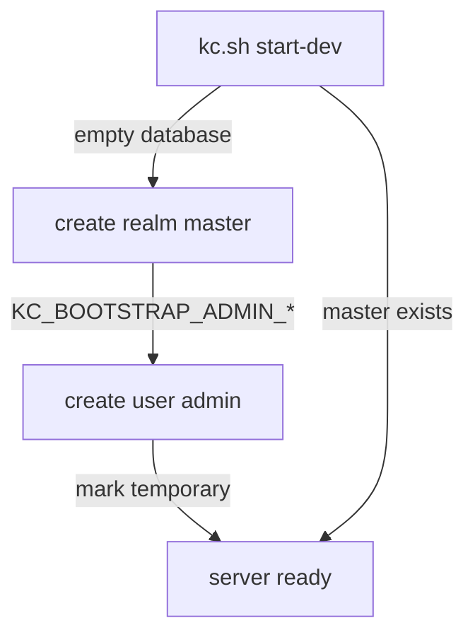

# The Master Realm And The Bootstrap Administrator

Every Keycloak server starts with one realm that you did not create. Before you add anything to it, you need to know what that realm is for, how its first user got there, and why it is the wrong place for an application. This part follows a Keycloak pod from its first start to the moment you sign in to the Admin Console. You then look at a token from the `master` realm.

## What happens at the first start

A **realm** is a space in Keycloak that holds its own users, clients, roles, groups and settings. When Keycloak starts and finds an empty database, it creates the realm `master`. It then needs an administrator, because without one nobody can sign in to manage anything.

Keycloak can only create that first administrator in two ways. You can open the server from the same machine (a local connection), or you can give it the user name and password when it starts. A container has no local browser, so in Kubernetes you always use the second way. You set two environment variables, `KC_BOOTSTRAP_ADMIN_USERNAME` and `KC_BOOTSTRAP_ADMIN_PASSWORD`, and Keycloak creates that user in `master` at its first start:



The diagram shows that Keycloak creates `master` and the administrator only when the database is empty; on every later start it goes straight to ready.

Look at how the playground passes the two variables. They come from the Secret `keycloak-admin`, not from plain values in the Deployment:

<!-- astrona:playground:renew -->

```sh
kubectl -n realms-demo get deployment keycloak \
  -o jsonpath='{.spec.template.spec.containers[0].env}' | jq
```

The output is a JSON list of the container's environment variables. `KC_BOOTSTRAP_ADMIN_USERNAME` and `KC_BOOTSTRAP_ADMIN_PASSWORD` each have a `valueFrom.secretKeyRef` that names the Secret `keycloak-admin` and a key in it. The third entry, `KC_HEALTH_ENABLED`, turns on the health checks that the pod's probes use.

Two facts about these variables surprise people. First, they only matter on the first start. If an administrator already exists, Keycloak logs an error and starts anyway, so changing the Secret later does **not** change the password. Second, Keycloak marks this user as **temporary**. It is meant to get you in, so that you can create a permanent administrator and then remove the temporary one.

## Signing in to the Admin Console

The **Admin Console** is Keycloak's web interface for administrators. Its address is `/admin` on the Keycloak server. Forward the Service port to your machine in a second terminal, and leave it running:

```sh
kubectl -n realms-demo port-forward svc/keycloak 8080:8080
```

Then open `http://localhost:8080/admin` in your browser. Keycloak sends you to the sign-in page of the `master` realm. Sign in with the user name `admin` and the password `admin`, which are lab-only credentials.

After you sign in, the console shows a warning banner that you are signed in with a temporary administrator account. That banner is the temporary mark from the first start. The realm selector at the top left shows `master`, and **Manage realms** lists only that one realm.

## Why the application does not belong in master

At this point you could click **Clients** and create your application's client right here. It would work, and that is exactly the problem. The administrators of `master` can manage every realm on the server. Any user in `master` is one role assignment away from that power.

There are four reasons to keep applications out of `master`:

- **Blast radius.** A wrong role mapping on an application user in `master` can give that user control of the whole server. In an application realm, the same mistake stays inside that realm.
- **Different rules.** Administrators need strict settings: short sessions, strong passwords, often two-factor sign-in. An application's customers usually need different settings. Each realm has its own, so you never have to choose one set for both groups.
- **A clean issuer.** Every token names the realm that signed it. A token from `master` tells every API that its user came from the administration realm.
- **Moving and copying.** You export, import and delete realms as a whole. An application in its own realm can be moved to another server without taking the administrators with it, and `master` can never be deleted.

The Keycloak documentation says the same in one line: the `master` realm is only intended for creating and managing other realms.

## A token from master

You can see the issuer problem with one request. The `master` realm has a built-in client called `admin-cli`. It is a public client that allows the password grant, where a client sends a user name and password straight to Keycloak. OAuth 2.1 drops the password grant, and a real application uses the authorization code flow, but it is the quickest way to get a token from a terminal. Ask for a token for `admin` from the `tester` pod:

```sh
kubectl -n realms-demo exec deploy/tester -- curl -s \
  -d grant_type=password -d client_id=admin-cli \
  -d username=admin -d password=admin \
  http://keycloak:8080/realms/master/protocol/openid-connect/token \
  | jq -r .access_token \
  | jq -R 'split(".")[1] | gsub("-";"+") | gsub("_";"/") | . + ("=" * ((4 - length % 4) % 4)) | @base64d | fromjson | {iss, azp, preferred_username}'
```

The first `jq` takes the access token from the JSON response. The second one decodes the middle part of the token, the payload, and prints three claims. `iss` (issuer) is `http://keycloak:8080/realms/master`, `azp` (the client the token was issued to) is `admin-cli`, and `preferred_username` is `admin`. The realm name sits inside the issuer URL, and an API that trusts this issuer trusts every user of `master`.

You now know where `master` and its first user come from, and why an application gets a realm of its own. The open question is what a realm actually holds, and which URLs change when you create a second one.

## Common pitfalls

> [!WARNING]
> - **Changing `KC_BOOTSTRAP_ADMIN_PASSWORD` to reset the administrator password.** The variables only take effect when `master` does not exist yet. On every later start Keycloak logs an error and keeps the old password.
> - **Keeping the temporary administrator forever.** Keycloak marks it temporary for a reason. On a real server, create a permanent administrator and remove the bootstrap one.
> - **Putting the bootstrap password in the Deployment as a plain `value`.** Anyone who can read the Deployment can read it. Use a Secret and `secretKeyRef`.
> - **Creating the first application client in `master` "just to test".** Test setups become production setups. Create an application realm from the start.
