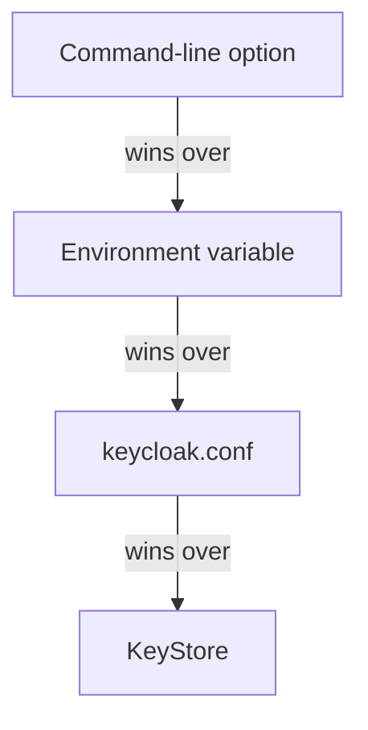

# Configuration Sources, Build Options And Runtime Options

A Keycloak setting such as the database host can come from four places at once: a command-line option, an environment variable, the configuration file and a key store. When two of them disagree, one wins, and the server never tells you that the other one was ignored. This part shows the four sources, the order they win in, and how one option name turns into each form. It then explains the split between build options and runtime options, which decides how a production image is made.

## Four sources, one order

Keycloak reads every option from four sources. When the same option is set in more than one, the source higher in this list wins:

1. **Command-line options** on `kc.sh`, for example `--db-url-host=postgres`.
2. **Environment variables**, for example `KC_DB_URL_HOST=postgres`.
3. **The configuration file** `conf/keycloak.conf`, for example a line `db-url-host=postgres`.
4. **A Java KeyStore**, a password-protected file that can hold sensitive values, under names such as `kc.db-password`.



The diagram shows the order: an option on the command line always beats the same option anywhere else.

In a Kubernetes Deployment, the first two sources are the ones you use most. The `args` list holds command-line options, and the `env` list holds environment variables. Environment variables are the usual choice, because a value can come from a Secret or a ConfigMap without appearing in the pod's command line.

## One option, three spellings

Every option has one name, written in lower case with hyphens, such as `db-url-host`. Each source spells it in its own way:

| Source | Form | Example |
| --- | --- | --- |
| Command line | `--` plus the name | `--db-url-host=postgres` |
| Environment variable | `KC_` plus the name in upper case, with underscores | `KC_DB_URL_HOST=postgres` |
| `keycloak.conf` | The name as it is | `db-url-host=postgres` |

There is one more prefix to know. Keycloak expands `${...}` expressions in values, so a password that contains a `$` sign can change when the server reads it. The prefix `KCRAW_` keeps the value exactly as it is: `KCRAW_DB_PASSWORD` instead of `KC_DB_PASSWORD`.

Now look at what the playground pod sets. Print every environment variable that starts with `KC_`:

<!-- astrona:playground:renew -->

```sh
kubectl -n image-demo exec deploy/keycloak -- sh -c 'env | grep ^KC_'
```

You see three variables. `KC_BOOTSTRAP_ADMIN_USERNAME` and `KC_BOOTSTRAP_ADMIN_PASSWORD` create the first administrator in the `master` realm, and `KC_HEALTH_ENABLED=true` turns on the health endpoints. The values of the first two come from the Secret `keycloak-admin`. The pod shows the plain values, because Kubernetes copies the Secret into the container's environment.

Then read the configuration file that ships with the image:

```sh
kubectl -n image-demo exec deploy/keycloak -- cat /opt/keycloak/conf/keycloak.conf
```

The file holds only comments with example lines, such as a commented-out `db=postgres`. No line is active, so this source sets nothing in the playground. Every setting the server uses here comes from the `args` list and the `env` list.

## Build options and runtime options

Keycloak sorts its options into two kinds. A **runtime option** is read every time the server starts, for example `hostname`, `db-url-host` or `db-password`. A **build option** changes which parts of the server are put together, for example `db` (the database vendor), `health-enabled`, `metrics-enabled` and the list of features. Keycloak's option reference marks build options with a tool icon.

Build options exist because Keycloak is built on Quarkus, a Java framework that does much of its setup ahead of time. The command `kc.sh build` applies the build options once and saves the result inside `/opt/keycloak`. A later `kc.sh start --optimized` then skips that work and starts faster.

If you run `kc.sh start` without `--optimized`, Keycloak checks the build options first and runs the build step itself when they changed. The server still starts, but every pod start takes longer. That is what the playground does today: `start-dev` always does this build step, which is one reason development mode is slow to start.

## An optimized image

For production, you build the build options into your own image once. Read this `Containerfile`; you do not build it in the playground. Save it as `Containerfile` if you want to keep it:

```dockerfile
FROM quay.io/keycloak/keycloak:26.8.1 AS builder

# Build options: fixed into the image by kc.sh build
ENV KC_DB=postgres
ENV KC_HEALTH_ENABLED=true
ENV KC_METRICS_ENABLED=true

RUN /opt/keycloak/bin/kc.sh build

FROM quay.io/keycloak/keycloak:26.8.1
COPY --from=builder /opt/keycloak/ /opt/keycloak/

ENTRYPOINT ["/opt/keycloak/bin/kc.sh"]
```

The first stage, `builder`, sets three build options and runs `kc.sh build`. The second stage starts again from the clean image and copies the built `/opt/keycloak` folder into it. A pod that runs this image uses `args: ["start", "--optimized"]` and gets only runtime options, such as the hostname and the database password, from its environment.

Keep secrets out of the build stage. Build options are saved inside the image, and anyone who can pull the image can read them. The database password is a runtime option for that reason, and it belongs in a Kubernetes Secret.

You now know where Keycloak reads its settings from, which source wins, and how to write any option in each form. You also know why a production image runs `kc.sh build` once. The open question is which settings production mode actually requires, because `start` refuses to run without them.

## Common pitfalls

> [!WARNING]
> - **Setting an option twice and changing the wrong copy.** A command-line option beats an environment variable with the same name. If a change in `env` does nothing, look in `args` first.
> - **Misspelling the environment variable.** It is `KC_` plus the option name in upper case with underscores. `KC_DBURLHOST` or `KEYCLOAK_DB_URL_HOST` is ignored without an error.
> - **Changing a build option on an optimized image.** With `start --optimized`, the build is already done. Change the build option in the image build and build the image again.
> - **Putting a password in a build stage.** Build options are stored in the image. Pass secrets at runtime, from a Secret.
