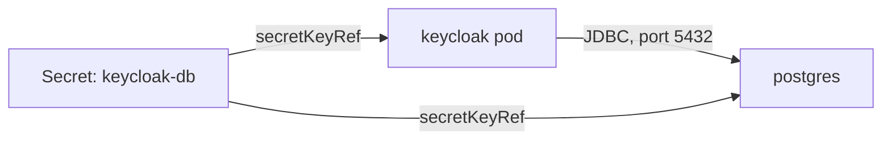

# From dev-file To PostgreSQL

A Keycloak server is only as durable as the place it stores its data. Out of the box, that place is `dev-file`, a database file inside the container. This part shows what that means when a pod is replaced, then moves Keycloak to PostgreSQL and proves, from PostgreSQL itself, that the data is there.

## Watch dev-file lose a realm

Keycloak's `db` option chooses the database vendor. Its default is `dev-file`: an embedded database that Keycloak runs inside its own process and stores as a file under `/opt/keycloak/data`. It needs no server, which makes it handy for a quick test. That file lives in the container's own file system, so a new pod starts without it.

See it happen. First define a helper that runs `kcadm.sh`, Keycloak's administration command-line tool, inside the Keycloak pod, and sign it in to the `master` realm with the lab-only administrator:

<!-- astrona:playground:renew -->

```sh
NAMESPACE=database-demo
kcadm() {
  kubectl -n "$NAMESPACE" exec -i deploy/keycloak -- \
    /opt/keycloak/bin/kcadm.sh "$@" --config /tmp/kcadm.config
}
kcadm config credentials --server http://localhost:8080 --realm master --user admin --password admin
```

The helper keeps the `kcadm.sh` session file in `/tmp` inside the pod. Now create a realm named `scratch`, list the realms, delete the pod, and list them again once the new pod is ready:

```sh
kcadm create realms -s realm=scratch -s enabled=true
kcadm get realms --fields realm
kubectl -n database-demo delete pod -l app=keycloak
kubectl -n database-demo rollout status deployment/keycloak --timeout=600s
kcadm config credentials --server http://localhost:8080 --realm master --user admin --password admin
kcadm get realms --fields realm
```

Before the restart, the list holds `master` and `scratch`. After it, only `master` is left. The new pod started with a new, empty `dev-file`, and Keycloak created `master` and the bootstrap administrator again from the environment variables. You had to sign in again because the session file in `/tmp` was deleted with the old pod.

## The database options

Keycloak connects to an external database with a handful of options. Each one has the usual command-line and environment variable forms:

| Option | Environment variable | Value for this playground |
| --- | --- | --- |
| `db` | `KC_DB` | `postgres`, the vendor |
| `db-url-host` | `KC_DB_URL_HOST` | `postgres`, the name of the PostgreSQL Service |
| `db-url-database` | `KC_DB_URL_DATABASE` | `keycloak`, the database name |
| `db-username` | `KC_DB_USERNAME` | the user name, from the Secret `keycloak-db` |
| `db-password` | `KC_DB_PASSWORD` | the password, from the Secret `keycloak-db` |

From the vendor, host and database, Keycloak builds the Java Database Connectivity (JDBC) URL itself, the connection string Java programs use: `jdbc:postgresql://postgres/keycloak`. You can also give a full URL with `db-url`; then the host and database options are ignored. Keycloak 26.8.1 supports PostgreSQL 14 to 18.

`db` is a build option, while the host, user name and password are runtime options. In development mode that difference does not matter, because `start-dev` builds at every start. In an optimized image, `db=postgres` belongs in the image build.

The password needs care. Written as `--db-password` in `args` or as a plain `value` in `env`, it is visible to anyone who can read the Deployment. A `secretKeyRef` keeps it in the Secret, and Kubernetes copies it into the container's environment when the pod starts.

## Move Keycloak to PostgreSQL

The Deployment below keeps `start-dev` and adds the five database variables, with the user name and password read from the Secret `keycloak-db`. Save this as `deployment-keycloak-postgres.yaml`:

```yaml
apiVersion: apps/v1
kind: Deployment
metadata:
  name: keycloak
  namespace: database-demo
  labels:
    app: keycloak
spec:
  replicas: 1
  strategy:
    type: Recreate
  selector:
    matchLabels:
      app: keycloak
  template:
    metadata:
      labels:
        app: keycloak
    spec:
      containers:
        - name: keycloak
          image: quay.io/keycloak/keycloak:26.8.1
          args: ["start-dev"]
          env:
            - name: KC_BOOTSTRAP_ADMIN_USERNAME
              valueFrom:
                secretKeyRef:
                  name: keycloak-admin
                  key: username
            - name: KC_BOOTSTRAP_ADMIN_PASSWORD
              valueFrom:
                secretKeyRef:
                  name: keycloak-admin
                  key: password
            - name: KC_HEALTH_ENABLED
              value: "true"
            - name: KC_DB
              value: postgres
            - name: KC_DB_URL_HOST
              value: postgres
            - name: KC_DB_URL_DATABASE
              value: keycloak
            - name: KC_DB_USERNAME
              valueFrom:
                secretKeyRef:
                  name: keycloak-db
                  key: username
            - name: KC_DB_PASSWORD
              valueFrom:
                secretKeyRef:
                  name: keycloak-db
                  key: password
          ports:
            - name: http
              containerPort: 8080
            - name: management
              containerPort: 9000
          startupProbe:
            httpGet:
              path: /health/started
              port: management
            periodSeconds: 5
            failureThreshold: 60
          readinessProbe:
            httpGet:
              path: /health/ready
              port: management
            periodSeconds: 10
          livenessProbe:
            httpGet:
              path: /health/live
              port: management
            periodSeconds: 10
          resources:
            requests:
              memory: 768Mi
              cpu: 250m
            limits:
              memory: 1536Mi
```

Apply it:

```sh
kubectl apply -f deployment-keycloak-postgres.yaml
```

Then check the result. Wait for the new pod, and ask PostgreSQL for its tables and for the rows of the table `realm`:

```sh
kubectl -n database-demo rollout status deployment/keycloak --timeout=600s
kubectl -n database-demo exec deploy/postgres -- psql -U keycloak -d keycloak -c '\dt'
kubectl -n database-demo exec deploy/postgres -- psql -U keycloak -d keycloak -c 'select name from realm;'
```

`\dt` lists many tables that did not exist before, such as `realm`, `client` and `user_entity`. Keycloak created them on its first start against the empty database. The table `realm` holds one row, `master`. When the readiness probe passes, `/health/ready` also confirms that Keycloak can reach the database.



The diagram shows Keycloak connecting to PostgreSQL over JDBC, with both sides reading the same user name and password from the Secret `keycloak-db`.

Now repeat the experiment from the start of this part: sign `kcadm` in again, create the realm `scratch`, delete the Keycloak pod, wait for the new one, and list the realms. This time `scratch` is still there after the restart, because it is a row in PostgreSQL and not a file in the container.

You now have a Keycloak whose data outlives its pods, with no password in the Deployment. The open question is how a new server gets the realm an application needs, without someone clicking through the Admin Console.

## Common pitfalls

> [!WARNING]
> - **Running anything real on `dev-file`.** Every pod replacement, rescheduling or image update starts with an empty database. In production mode Keycloak also warns that the `dev-file` default is deprecated.
> - **Writing the password into the Deployment.** A plain `value` or `--db-password` is readable by anyone who can read the Deployment. Use `secretKeyRef`.
> - **Pointing at the wrong host.** `KC_DB_URL_HOST` is the name of the PostgreSQL Service, not the pod name. If Keycloak cannot connect, it never becomes ready; read `kubectl logs` for the connection error.
> - **Setting `db-url` and `db-url-host` together.** A full `db-url` wins, and the host and database options are ignored without an error.
