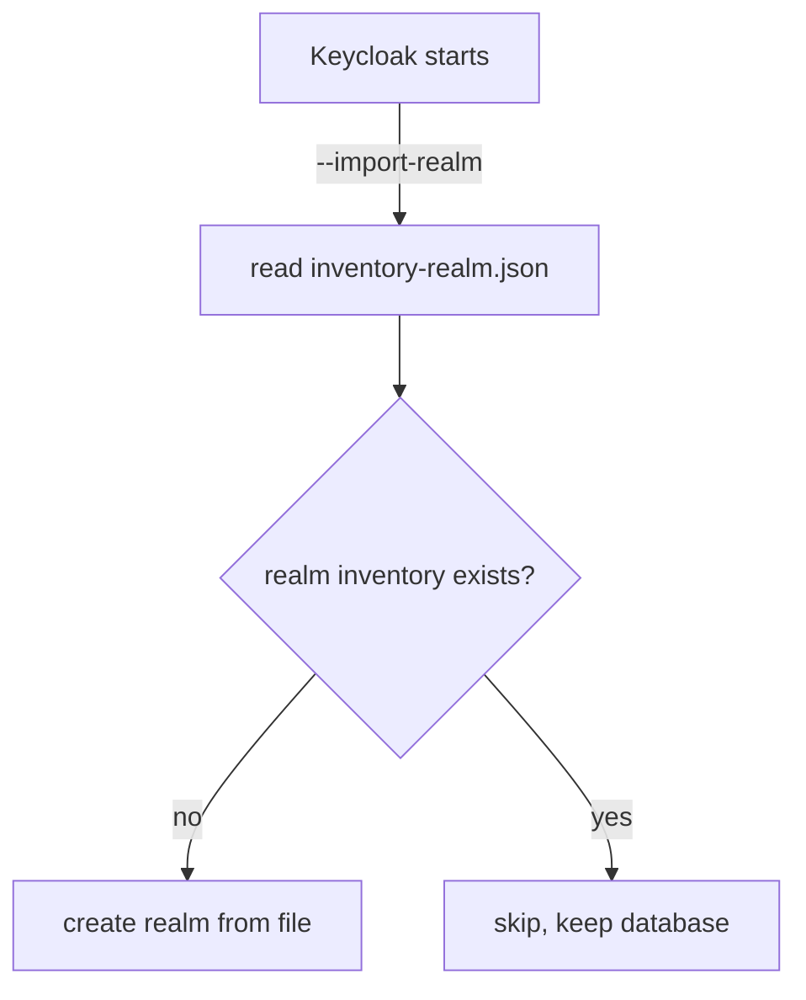

# Importing And Exporting A Realm

A new Keycloak server holds one realm, `master`, and nothing an application can use. Building the application realm by hand in the Admin Console is slow, and nobody can review what was clicked. Keycloak can instead create a realm from a JSON file when it starts, and write a realm back to a file. This part imports the `inventory` realm from a ConfigMap, shows the one rule that surprises everyone, and exports a realm safely.

## The realm file and the import folder

A realm file is a JSON document that describes one realm: its settings, and optionally its users, clients, roles and groups. Keycloak reads realm files from one folder, `/opt/keycloak/data/import`, when the server starts with the option `--import-realm`. It reads every regular `.json` file in that folder and ignores subfolders. By convention, a realm file is named `<realm name>-realm.json`.

Look at the realm file the playground already holds in the ConfigMap `inventory-realm`:

<!-- astrona:playground:renew -->

```sh
kubectl -n database-demo get configmap inventory-realm -o jsonpath='{.data.inventory-realm\.json}'
```

The JSON names the realm `inventory` and sets `enabled` to `true`. It holds one user, `alice`, with an email address, a first and last name and a password credential `alice-password`, so her user profile is complete. It also holds one client, `inventory-cli`, a public client with **Direct access grants** turned on. A public client is a client that cannot keep a secret, such as a command-line tool.

A ConfigMap mounted as a volume turns each key into a file. Mount `inventory-realm` at `/opt/keycloak/data/import`, and the container sees the file `/opt/keycloak/data/import/inventory-realm.json`.

## Import the realm at start

The Deployment below keeps the PostgreSQL settings, adds `--import-realm` to `args`, and mounts the ConfigMap at the import folder. Save this as `deployment-keycloak-import.yaml`:

```yaml
apiVersion: apps/v1
kind: Deployment
metadata:
  name: keycloak
  namespace: database-demo
  labels:
    app: keycloak
spec:
  replicas: 1
  strategy:
    type: Recreate
  selector:
    matchLabels:
      app: keycloak
  template:
    metadata:
      labels:
        app: keycloak
    spec:
      containers:
        - name: keycloak
          image: quay.io/keycloak/keycloak:26.8.1
          args: ["start-dev", "--import-realm"]
          env:
            - name: KC_BOOTSTRAP_ADMIN_USERNAME
              valueFrom:
                secretKeyRef:
                  name: keycloak-admin
                  key: username
            - name: KC_BOOTSTRAP_ADMIN_PASSWORD
              valueFrom:
                secretKeyRef:
                  name: keycloak-admin
                  key: password
            - name: KC_HEALTH_ENABLED
              value: "true"
            - name: KC_DB
              value: postgres
            - name: KC_DB_URL_HOST
              value: postgres
            - name: KC_DB_URL_DATABASE
              value: keycloak
            - name: KC_DB_USERNAME
              valueFrom:
                secretKeyRef:
                  name: keycloak-db
                  key: username
            - name: KC_DB_PASSWORD
              valueFrom:
                secretKeyRef:
                  name: keycloak-db
                  key: password
          ports:
            - name: http
              containerPort: 8080
            - name: management
              containerPort: 9000
          startupProbe:
            httpGet:
              path: /health/started
              port: management
            periodSeconds: 5
            failureThreshold: 60
          readinessProbe:
            httpGet:
              path: /health/ready
              port: management
            periodSeconds: 10
          livenessProbe:
            httpGet:
              path: /health/live
              port: management
            periodSeconds: 10
          resources:
            requests:
              memory: 768Mi
              cpu: 250m
            limits:
              memory: 1536Mi
          volumeMounts:
            - name: realm-import
              mountPath: /opt/keycloak/data/import
              readOnly: true
      volumes:
        - name: realm-import
          configMap:
            name: inventory-realm
```

Apply it:

```sh
kubectl apply -f deployment-keycloak-import.yaml
```

Then check the result. Wait for the pod, and look for the import in the log:

```sh
kubectl -n database-demo rollout status deployment/keycloak --timeout=600s
kubectl -n database-demo logs deploy/keycloak | grep -i import
```

The log has a line that says the realm `inventory` was imported. Now prove the realm works by asking it for a token for `alice`. The request uses the password grant (`grant_type=password`), where the client sends the user's name and password directly. OAuth 2.1 drops this grant, and a real application uses the authorization code flow, but it lets you test a realm from a terminal. The `jq` filter decodes the middle part of the access token, a JSON Web Token (JWT), and prints two claims:

```sh
kubectl -n database-demo exec deploy/tester -- curl -s \
  -d grant_type=password -d client_id=inventory-cli \
  -d username=alice -d password=alice-password -d scope=openid \
  http://keycloak:8080/realms/inventory/protocol/openid-connect/token \
  | jq -r '.access_token | split(".")[1] | gsub("-";"+") | gsub("_";"/")
           | . + ("=" * ((4 - (length % 4)) % 4)) | @base64d | fromjson
           | {iss, preferred_username}'
```

The output names the issuer `http://keycloak:8080/realms/inventory` and the user `alice`. The realm, its user and its client exist on a server where nobody created them by hand. Because Keycloak now writes to PostgreSQL, `select name from realm;` in PostgreSQL also lists `inventory`.

## An existing realm is skipped

Keycloak runs `--import-realm` at every start, and the realm already exists after the first one. So what happens on the second start? **A startup import skips a realm that already exists.** It does not update it, and it does not delete anything.



The diagram shows the decision Keycloak makes for each realm file at start: create the realm when it is missing, skip it when it is there.

This rule protects the data. Users change their passwords and administrators add clients, and a restart must not undo that. The other side of the rule is that an edited ConfigMap does nothing to a realm that already exists. To force a file onto an existing realm, stop every Keycloak server and run `kc.sh import --file <file>`, which replaces existing realms by default (`--override true`).

## Export a realm

`kc.sh export` writes realms to files. `--dir <folder>` writes one file per realm and `--file <file>` writes one file. `--realm <name>` limits the export to one realm, and `--users` chooses where users go (`realm_file` puts them in the realm file). The export command reads the database directly, with the same database options as the server.

One rule matters more than the options: **the Keycloak server must not run while you export.** The export command starts a second Keycloak process. On the same machine as a running server, it can clash on ports and other resources. So scale the Deployment to zero, run the export in a separate pod with the same image and database settings, and scale back up afterwards.

Scale Keycloak down first:

```sh
kubectl -n database-demo scale deployment/keycloak --replicas=0
```

Save this as `job-keycloak-export.yaml`:

```yaml
apiVersion: batch/v1
kind: Job
metadata:
  name: keycloak-export
  namespace: database-demo
spec:
  backoffLimit: 0
  template:
    spec:
      restartPolicy: Never
      containers:
        - name: export
          image: quay.io/keycloak/keycloak:26.8.1
          command: ["/bin/bash", "-c"]
          args:
            - >-
              /opt/keycloak/bin/kc.sh export --file /tmp/inventory-export.json
              --realm inventory --users realm_file
              && echo '--- inventory-export.json ---'
              && cat /tmp/inventory-export.json
          env:
            - name: KC_DB
              value: postgres
            - name: KC_DB_URL_HOST
              value: postgres
            - name: KC_DB_URL_DATABASE
              value: keycloak
            - name: KC_DB_USERNAME
              valueFrom:
                secretKeyRef:
                  name: keycloak-db
                  key: username
            - name: KC_DB_PASSWORD
              valueFrom:
                secretKeyRef:
                  name: keycloak-db
                  key: password
```

Apply it:

```sh
kubectl apply -f job-keycloak-export.yaml
```

Then check the result, and scale Keycloak back up:

```sh
kubectl -n database-demo wait --for=condition=complete job/keycloak-export --timeout=600s
kubectl -n database-demo logs job/keycloak-export | sed -n '/--- inventory-export.json ---/,$p'
kubectl -n database-demo scale deployment/keycloak --replicas=1
```

This Job sets `command`, unlike the Deployment, because it runs a shell that calls `kc.sh` and then prints the file. The log starts with Keycloak's own startup lines, then the marker line, then the exported realm as JSON. The export holds much more than the ConfigMap: every default setting of the realm, its default roles and clients, and `alice` with a hashed password instead of the plain one.

The Admin Console has a second way to export: **Realm settings**, then **Action**, then **Partial export**. It works on a running server, but it masks client secrets with `*` and leaves out users. That makes it useful for reviewing a configuration, and useless as a backup.

You can now create a realm from a file at start, explain why a restart never overwrites it, and export a realm without risking a clash with the running server. The open question is how all of this fits into one production server, which needs a hostname and health checks as well as a database.

## Common pitfalls

> [!WARNING]
> - **Editing the realm file and expecting a restart to apply it.** A startup import skips a realm that already exists. Change the live realm, or stop the servers and run `kc.sh import`.
> - **Mounting the file in the wrong place.** Only `/opt/keycloak/data/import` is read, only with `--import-realm`, and only regular `.json` files at the top of the folder.
> - **Exporting from the running pod.** The export command must not run beside a running server. Scale to zero and use a separate pod.
> - **Treating a partial export as a backup.** It masks secrets and leaves out users. Back up the database instead.

## Your mission: Move Keycloak To PostgreSQL With An Imported Realm

You can now point Keycloak at PostgreSQL with credentials from a Secret, and import a realm from a ConfigMap at start. The graded lab gives you a Keycloak on `dev-file` with an unused PostgreSQL and an unmounted realm file, and asks you to move the data to PostgreSQL and import the realm, so that `alice` can get a token.

The lab runs in its own cluster, so first pause your playground. Nothing in it is lost:

```sh
astrona stop ats-088-playground-030-02
```

Then start the lab:

```sh
astrona run --git ssh://git@github.com/astrona-io/ATS088.git -c sections/section-030/module-02/labs/lab-01
```

The task is on the next page. Solve it on your own first. When you think you are done, send it for grading:

```sh
astrona submit -c sections/section-030/module-02/labs/lab-01
```

When the lab is done, remove it and start your playground again:

```sh
astrona destroy ats-088-lab-030-02
astrona start ats-088-playground-030-02
```
