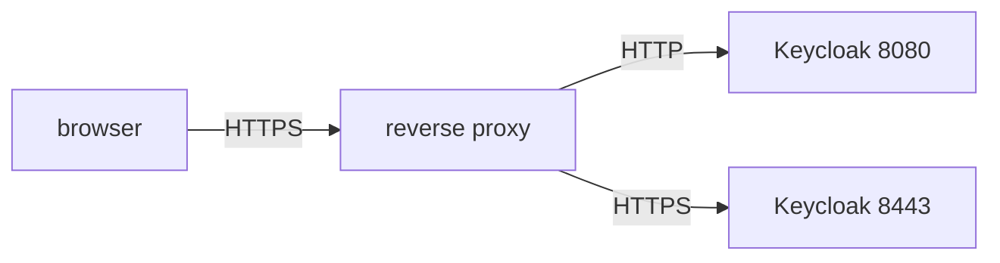

# Where TLS Ends

A user types `https://id.example.test` in a browser, and the request must travel across networks that the organization does not control. Somewhere on the way, the encrypted request becomes a plain HTTP request that Keycloak can read. The place where that happens is a design decision, and Keycloak has settings for each choice. This part compares the three layouts and shows what Keycloak does when it receives plain HTTP.

## Three layouts

**TLS termination** means decrypting TLS traffic. With **edge termination**, a reverse proxy or load balancer ends TLS and sends plain HTTP to Keycloak. This is simple, and the proxy holds the certificate. The hop between the proxy and Keycloak is not encrypted, so it must stay on a trusted network.

With **re-encryption**, the proxy ends TLS and opens a new TLS connection to Keycloak. The last hop is encrypted too, and Keycloak needs its own certificate. With **passthrough**, the proxy does not decrypt anything. It forwards the encrypted bytes, and Keycloak ends TLS itself. A passthrough proxy cannot read or change HTTP headers, so Keycloak sees the address of the proxy and not the address of the client.



The diagram shows edge termination on the upper path, where the proxy sends HTTP to port `8080`, and re-encryption on the lower path, where the proxy sends HTTPS to port `8443`.

## What Keycloak requires

Keycloak starts in two modes. The command `kc.sh start-dev` is for development: it allows HTTP and works out its address from each request. The command `kc.sh start` is for production and is strict. It needs a hostname, set with the option `hostname` (environment variable `KC_HOSTNAME`). It also needs either a certificate for HTTPS, or the option `http-enabled` set to `true` for a server behind a proxy that ends TLS. Without these, `start` does not run.

<!-- astrona:playground:renew -->

Look at what the playground server does today. It runs in development mode, so it answers on plain HTTP. Request the discovery document of the `master` realm from the tester pod and print the issuer:

```sh
NAMESPACE=edge-demo
show_issuer() {
  base_url="$1"; shift
  kubectl -n "$NAMESPACE" exec deploy/tester -- \
    curl -sk "$@" "$base_url/realms/master/.well-known/openid-configuration" | jq -r .issuer
}
show_issuer http://keycloak:8080
```

The issuer is `http://keycloak:8080/realms/master`. In development mode Keycloak builds it from the address of the request. Now send the same request with a different `Host` header:

```sh
show_issuer http://keycloak:8080 -H 'Host: id.example.test'
```

The issuer now uses the host `id.example.test`. The server believed the header, because development mode has no fixed hostname. A production server must not do that, because any client could then make it return addresses of its choice.

## Ports and the second listener

Keycloak listens on three ports in this module. Port `8080` serves HTTP when `http-enabled` is true. Port `8443` serves HTTPS when a certificate is configured. Port `9000` is the management interface, with `/health` and `/metrics`, enabled by `KC_HEALTH_ENABLED` and `KC_METRICS_ENABLED`. Check which ports the Service exposes:

```sh
kubectl -n edge-demo get svc keycloak
```

The Service lists `8080` and `9000`. Port `8443` is not there, and no certificate is configured, so the server cannot answer HTTPS yet. Confirm that from the tester pod:

```sh
kubectl -n edge-demo exec deploy/tester -- curl -sk -o /dev/null -w '%{http_code}\n' https://keycloak:8443
```

The request cannot connect, and `curl` prints `000`. The next part gives the server a certificate and opens the port.

You now know the three layouts, which options a production server needs, and why a fixed hostname matters. The open question is how to give Keycloak a certificate and where to store it.

## Common pitfalls

> [!WARNING]
> - **Running `start-dev` in production.** It trusts the `Host` header and relaxes hostname checks.
> - **Assuming passthrough keeps the client address.** The proxy cannot add headers to encrypted traffic.
> - **Leaving the last hop in plain HTTP on an untrusted network.** Edge termination is only safe inside a trusted network.
> - **Starting `start` with neither a certificate nor `http-enabled`.** The server refuses to start.
